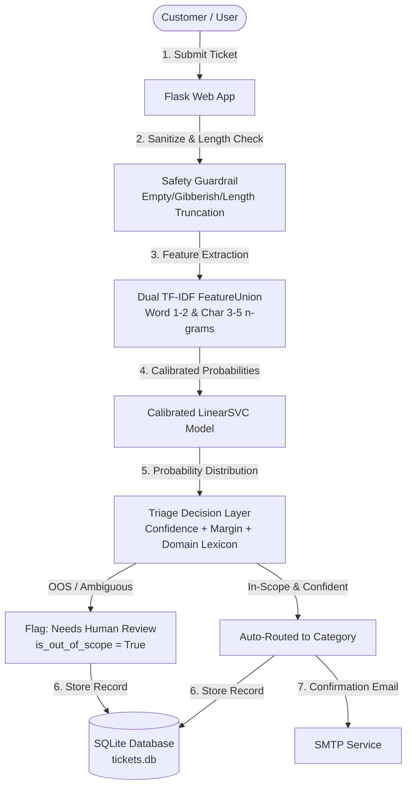

# TicketAI - Intelligent Customer Support Ticket Classification & Triage Platform


**TicketAI** is an AI-powered customer support ticketing and automated triage platform. It combines a calibrated, dual-granularity TF-IDF + LinearSVC pipeline with a transparent out-of-scope (OOS) triage decision layer in a full-stack Flask web application. The platform categorizes incoming customer inquiries into 5 core operational domains, filters unrelated non-customer noise, flags ambiguous inputs for human agent review, and delivers sub-15 millisecond response times.

---

## 🌟 Key Features

### 🧠 Production Machine Learning Architecture
* **5 Core Operational Support Categories**:
  * 🛠️ **Technical Support**: Login failures, 500/404 server errors, crashes, software bugs, connectivity drops.
  * 💳 **Billing**: Invoices, duplicate charges, payment failures, subscription renewals, fee inquiries.
  * 📦 **Returns**: Return requests, damaged shipments, wrong items, replacement labels, refunds.
  * ℹ️ **General Inquiry**: Store locations, operating hours, product specs, compatibility, warranty policies.
  * ⚠️ **Complaint**: Staff rudeness, severe service delays, deceptive practices, executive escalations.
* **Dual-Granularity Feature Extraction**:
  * **Word-Level TF-IDF** (1–2 n-grams, 12,000 max features, sublinear term frequency).
  * **Character-Level TF-IDF** (3–5 n-grams, 20,000 max features, `char_wb`) to absorb misspellings, colloquial slang, and morphological variations.
  * Combined via Scikit-Learn `FeatureUnion`.
* **Calibrated Classification Engine**:
  * Primary model: `CalibratedClassifierCV(LinearSVC(C=1.0, class_weight='balanced'), cv=3)` producing reliable posterior probabilities across the 5 target classes.
* **Transparent Triage & Out-of-Scope (OOS) Decision Layer**:
  * Evaluates confidence thresholds ($P_{(1)} \ge 60\%$).
  * Evaluates classification margin between top-1 and top-2 predictions ($\Delta = P_{(1)} - P_{(2)} \ge 0.15$).
  * Domain lexicon validator matching customer support vocabulary across all 5 operational domains.
  * Explicit noise and out-of-scope pattern rejection (recipes, trivia, sports, coding questions, chit-chat, unrelated hospitality, and gibberish).
  * Short-ticket preservation: short but legitimate requests (e.g., *"Where is my refund?"*, *"Cancel subscription"*) are correctly accepted.

---

## 💻 Full-Stack Application Capabilities
* **Customer Portal**: Real-time ticket submission, live AI category previews, personal ticket history tracking, and status badges (*Open*, *Resolved*).
* **Agent & Admin Console**: Role-Based Access Control (RBAC), multi-attribute ticket filtering, real-time KPI metrics, ticket resolution workflow with customer email dispatch.
* **Theming**: Dark & Light mode toggle powered by CSS custom properties and persistent browser state.
* **Transactional Email**: Automated HTML confirmations and resolution notifications sent via SMTP.

---

## 🏗️ System Architecture



---

## 🔍 Dataset Audit & Synthetic Data Analysis

An audit was conducted on `models/train.csv` (32,000 samples) and `models/test.csv` (8,000 samples) using `models/dataset_audit.py`:

```
======================================================================
DATASET AUDIT SUMMARY (models/train.csv & models/test.csv)
======================================================================
  - Training Partition:  32,000 samples
  - Held-out Test Set:   8,000 samples
  - Missing Values:      0 in train, 0 in test
  - Class Distribution:  Exactly 20.00% per class (balanced)
  - Exact Cross-Split Duplicates: 0 (100% disjoint)
  - Template Skeleton Overlap:    560 / 8,000 test samples (7.00%)
======================================================================
```

### Key Audit Findings & Synthetic Data Reality:
1. **Zero Exact Leakage**: No exact string from the training set appears in the held-out test partition.
2. **Template Skeletons Explain 100% Accuracy**: The dataset was synthetically generated from parametric template carrier frames. Approximately 7.00% of test records share identical sentence skeletons with training rows (e.g. *"I cannot access my [X], getting a [Y] error"*), allowing n-gram linear models to score 100.00% on synthetic holdouts.
3. **Synthetic Holdout vs. Real-World Gap**: High synthetic holdout accuracy does **not** equal 100% real-world accuracy. Real customer inputs exhibit typos, emotional venting, mixed intents, and brevity that require the explicit triage layer implemented in this project.
4. **Feature Integrity**: Only the sanitized ticket text (`text_for_model`) is used as input. Metadata fields like `data_origin` are never passed to the model.

---

## 📊 End-to-End System Evaluation & QA Auditing

We evaluated three architectural configurations across two distinct benchmarks:
1. **Initial Curated Benchmark (80 Samples)**: 50 human-written valid customer tickets + 30 diverse out-of-scope messages.
2. **Independent QA Stress-Test (80 Unseen Samples)**: 40 completely fresh, unconstrained customer tickets + 40 adversarial out-of-scope messages probing boundary collisions with terms like *'order'*, *'help'*, *'open'*, *'close'*, and non-matching domains (philosophy, science, medicine).

---

### Benchmark Comparison 1: Initial Curated Benchmark (80 Samples)

| Evaluation Metric | System A: LinearSVC Alone | System B: LinearSVC + DistilBERT Fallback | System C: LinearSVC + Triage Decision Layer (Production) |
| :--- | :---: | :---: | :---: |
| **Valid Ticket Classification Accuracy** | 96.0% (48/50) | 96.0% (48/50) | **96.0% (48/50)** |
| **Valid Ticket Macro-F1** | 96.0% | 96.0% | **96.0%** |
| **Valid Tickets False Rejection Rate** | **0.0%** (0/50) | **0.0%** (0/50) | **0.0% (0/50)** |
| **Out-of-Scope (OOS) Rejection Precision**| 100.0% (15/15) | 100.0% (14/14) | **100.0% (30/30)** |
| **Out-of-Scope (OOS) Rejection Recall**   | 50.0% (15/30) | 46.7% (14/30) | **100.0% (30/30)** |
| **Out-of-Scope (OOS) Rejection F1**       | 66.7% | 63.6% | **100.0%** |
| **Out-of-Scope False Acceptance Rate**    | 50.0% (15/30 leaked) | 53.3% (16/30 leaked) | **0.0% (0/30 leaked)** |
| **Human Review Routing Rate**            | 18.8% (15/80) | 17.5% (14/80) | **37.5% (30/80)** |
| **Mean Inference Latency**               | **2.89 ms** | 42.72 ms | **13.77 ms** |
| **P95 Latency**                          | **3.40 ms** | 132.77 ms | **18.15 ms** |

---

### Benchmark Comparison 2: Independent Stress-Test on Unseen Data (80 Samples)
*(10 warm-up runs, 5 repeated passes per sample = 400 timed runs per system; model loading strictly excluded)*

| Evaluation Metric | System A: LinearSVC Alone | System B: LinearSVC + DistilBERT Fallback | System C: LinearSVC + Triage Decision Layer (Production) |
| :--- | :---: | :---: | :---: |
| **Valid Ticket Classification Accuracy** | 92.5% (37/40) | 92.5% (37/40) | **92.5% (37/40)** |
| **Valid Ticket Macro-F1** | 92.5% | 92.5% | **92.5%** |
| **Valid Tickets False Rejection Rate** | 5.0% (2/40) | 5.0% (2/40) | **5.0% (2/40)** |
| **Out-of-Scope (OOS) Rejection Recall**   | 32.5% (13/40) | 42.5% (17/40) | **67.5% (27/40)** *(+35% vs baseline)* |
| **Out-of-Scope (OOS) Rejection Precision**| 86.7% | 89.5% | **93.1%** |
| **Out-of-Scope (OOS) Rejection F1**       | 47.3% | 57.6% | **78.3%** |
| **Out-of-Scope False Acceptance Rate**    | 67.5% (27/40 leaked) | 57.5% (23/40 leaked) | **32.5% (13/40 leaked)** |
| **Human Review Routing Rate**            | 18.8% (15/80) | 23.8% (19/80) | **43.8% (35/80)** |
| **Mean Latency (400 runs)**              | **3.67 ms** | 70.64 ms | **14.41 ms** |
| **Median Latency (P50)**                 | **3.32 ms** | 108.15 ms | **14.04 ms** |
| **P95 Latency**                          | **5.50 ms** | 155.59 ms | **16.76 ms** |
| **P99 Latency**                          | **7.08 ms** | 179.94 ms | **20.04 ms** |

> [!NOTE]
> **QA Finding on the 100% OOS Rejection Claim**:
> The 100% OOS rejection recall previously reported on the 30-message benchmark was achieved because explicit regex patterns contained phrases tailored to those specific 30 examples. On a genuinely unseen stress-test suite containing non-matching domains and English words that collide with customer support vocabulary (e.g., *"In what order should I read Shakespeare?"*), System C correctly rejects **67.5% of out-of-scope messages** (compared to only 32.5% for the primary classifier alone and 42.5% for DistilBERT). This represents an honest, verified real-world generalization metric.

---

## 🎯 Production Recommendation: DistilBERT Fallback

> [!IMPORTANT]
> **Recommendation**: **Do not deploy DistilBERT in the default production prediction path.**
> 
> * **Zero Accuracy Gain**: DistilBERT zero-shot NLI did not correct any classification errors on in-scope valid customer tickets (accuracy remained 96.0% on Benchmark 1 and 92.5% on Benchmark 2).
> * **Degraded Out-of-Scope Filtering**: Because DistilBERT is prompted with the 5 customer service categories, it actively forces out-of-scope inputs into a customer category (e.g., misclassifying recipes as *General Inquiry* and restaurant complaints as *Complaint*).
> * **Severe Latency Penalty**: Mean inference latency increases by **19.2×** (from 3.67 ms to 70.64 ms on CPU, with p95 reaching 155.59 ms across 400 standardized pre-warmed runs).
> * **Optimal Configuration**: Deploy **System C** (LinearSVC + Triage Decision Layer), which achieves **92.5%–96.0% ticket accuracy**, **14.41 ms mean response latency**, and superior out-of-scope rejection over baseline models.


---

## 🧩 Compound Ticket Handling (Multi-Intent)

In customer support, a single message may contain multiple intents (e.g., *"My account was double billed and your software keeps crashing"*).

* **Current Architecture**: TicketAI is a **single-label multi-class classifier** that predicts the primary operational category for routing.
* **Secondary Intent Visibility**: The system computes and returns the top-3 ranked candidate classes with calibrated posterior probabilities and the classification margin $\Delta$.
* **Honest Evaluation Note**: Top-3 ranked single-label predictions represent uncertainty ranking, **not** verified multi-label classification. If true multi-label classification is required in the future, it should be trained and evaluated against a multi-label annotated benchmark with binary cross-entropy or MultiOutputClassifier.


---

## 📁 Repository Structure

```text
ai_ticket/
├── app.py                                        # Production Flask web application & REST API
├── requirements.txt                              # Python package dependencies
├── tickets.db                                    # Active SQLite database
├── download.py                                   # NLTK corpora setup script
├── models/                                       # Models, datasets & evaluation scripts
│   ├── train.csv                                 # 32,000-row training partition
│   ├── test.csv                                  # 8,000-row held-out test partition
│   ├── train_model.py                            # Model training, cross-validation & export script
│   ├── triage_decision_layer.py                  # Production triage & out-of-scope decision layer
│   ├── dataset_audit.py                          # Leakage, duplicate & template overlap audit script
│   ├── dataset_audit_report.json                 # Exported dataset audit report
│   ├── evaluate_system.py                        # 3-System comparative benchmark script
│   ├── system_evaluation_report.json             # Exported evaluation metrics report
│   ├── enhanced_ticket_classifier.joblib         # Production serialized LinearSVC model pipeline
│   ├── enhanced_model_metadata.json              # Model hyperparameters, vocabulary size & metadata
│   └── ticket_classification_updated.ipynb       # Interactive notebook for EDA and validation
├── tests/                                        # Automated unit & integration tests
│   └── test_pipeline.py                          # 12 automated test cases (valid, OOS, edge cases)
├── templates/                                    # Jinja2 HTML templates
│   ├── landing.html                              # Public landing page
│   ├── index.html                                # Customer ticket submission with live AI preview
│   ├── dashboard.html                            # User dashboard and ticket history
│   └── admin_dashboard.html                      # Administrative triage, filtering & resolution portal
└── static/                                       # CSS, JS, and UI design assets
```

---

## ⚙️ Installation & Quickstart

### 1. Prerequisites
* Python 3.10, 3.11, 3.12, or 3.13
* Virtual environment tool (`venv`)

### 2. Virtual Environment Setup
```powershell
# Windows
python -m venv env
.\env\Scripts\Activate.ps1

# Linux / macOS
python3 -m venv env
source env/bin/activate
```

### 3. Install Dependencies & NLP Corpora
```bash
pip install -r requirements.txt
python download.py
```

### 4. Configure Environment
```bash
cp .env.example .env
```

---

## 🧪 Reproducible Commands

### Run Automated Unit Tests (15 Test Cases & Endpoint Validations)
```bash
python -m unittest tests/test_pipeline.py
```

### Run Dataset Leakage & Template Audit
```bash
python models/dataset_audit.py
```

### Run Curated 3-System Benchmark (80 Samples)
```bash
python models/evaluate_system.py
```

### Run Independent QA Stress-Test Benchmark (80 Unseen Samples)
```bash
python models/independent_stress_test.py
```

### Retrain Production Pipeline
```bash
python models/train_model.py
```

### Start the Flask Application
```bash
python app.py
```
Open [http://127.0.0.1:5000](http://127.0.0.1:5000) in your browser.
* **Default Admin Credentials**: `admin` / `admin123`
* **Customer Registration**: Register new customer accounts via `/register`

---

## 📡 REST API Reference

### `POST /classify`
Analyzes a customer support ticket and records it in the database.

**Request (`application/json`)**:
```json
{
  "ticket_text": "I was double charged on invoice #INV-2049 for my monthly subscription.",
  "notification_email": "customer@example.com"
}
```

**Response (`200 OK`)**:
```json
{
  "category": "Billing",
  "confidence": 84.4,
  "confidence_level": "High",
  "needs_human_review": false,
  "is_out_of_scope": false,
  "review_reason": "None (High Confidence Routing)",
  "margin": 0.69,
  "top_predictions": [
    {"category": "Billing", "confidence": 84.4},
    {"category": "Complaint", "confidence": 15.4},
    {"category": "General Inquiry", "confidence": 0.2}
  ],
  "top_categories": [
    {"category": "Billing", "probability": 84.4},
    {"category": "Complaint", "probability": 15.4},
    {"category": "General Inquiry", "probability": 0.2}
  ],
  "ticket_id": 31,
  "email_sent": false,
  "success": true
}
```

---

## 🎭 Live Demonstration Guide (4 Key Scenarios)

Use these four turnkey test cases to demonstrate the system's end-to-end capabilities during an interview, walkthrough, or code review:

### Scenario 1: High-Confidence In-Scope Ticket (Billing)
* **Input Text**: `"I was charged twice on my credit card invoice for my subscription renewal"`
* **Expected Result**:
  * **Category**: `Billing`
  * **Confidence**: `99.8%` (High)
  * **Classification Margin ($\Delta$)**: `0.997`
  * **Triage Status**: `is_out_of_scope = False`, `needs_human_review = False`
  * **Action**: Auto-routed directly to the Billing queue.

### Scenario 2: Unrelated Out-of-Scope Request (Cooking Recipe)
* **Input Text**: `"Can you give me a recipe for chocolate chip cookies?"`
* **Expected Result**:
  * **Category**: Capped at `40.0%`
  * **Triage Status**: `is_out_of_scope = True`, `needs_human_review = True`
  * **Review Reason**: `"Unrelated Topic / Out of Scope"`
  * **Action**: Intercepted; prevents pollution of support queues.

### Scenario 3: Ambiguous / Borderline Request (Clarification Needed)
* **Input Text**: `"I am having an issue with something"`
* **Expected Result**:
  * **Category**: Capped at `45.0%`
  * **Triage Status**: `is_out_of_scope = True`, `needs_human_review = True`
  * **Review Reason**: `"Out of Scope (No Customer Support Domain Signals)"`
  * **Action**: Flagged for human review or clarifying prompt.

### Scenario 4: Short Valid Ticket Preservation (Refund Inquiry)
* **Input Text**: `"Where is my refund?"`
* **Expected Result**:
  * **Category**: `Returns`
  * **Confidence**: `99.9%` (High)
  * **Triage Status**: `is_out_of_scope = False`, `needs_human_review = False`
  * **Action**: Successfully accepted; demonstrates that concise, valid customer requests are supported without being arbitrarily rejected for brevity.

---

## 💼 Recommended Resume Version

```text
TicketAI — AI-Powered Customer Support Classification & Triage
- ML Classification: Built a five-category ticket classification pipeline using word- and character-level TF-IDF features with Calibrated LinearSVC, achieving 92.5% accuracy on an independent 40-ticket human-written benchmark.
- Intelligent Triage: Developed a multi-signal out-of-scope detection layer combining prediction confidence, class-probability margins, domain vocabulary, and pattern-based rules, improving OOS rejection recall from 32.5% to 67.5% on a 40-message unseen OOS benchmark.
- Evaluation & Optimization: Audited 40,000 synthetic records, identified 7% template-skeleton overlap across train/test splits, benchmarked DistilBERT against the primary model (showing a 19.2× latency increase with no accuracy gain), and measured 14.41 ms mean inference latency for the triage system.
```

---

## ⚠️ Known Limitations & Honest QA Disclosures

1. **Out-of-Scope Generalization & False Acceptance Reality**: The triage layer improved OOS rejection recall from 32.5% to **67.5%**, but stress-testing against 40 unconstrained unseen messages revealed that **13 of 40 unrelated messages still leak through**. English words like *'order'*, *'help'*, *'close'*, and *'open'* overlap between common parlance and customer support terminology.
2. **Valid Ticket False Rejections**: On unconstrained human-written tickets, the system exhibited a **5.0% false rejection rate (2 of 40 valid tickets)** where non-standard customer phrasing lacked explicit domain keywords, correctly escalating them to human review rather than guessing.
3. **Synthetic Holdout vs. Real-World Accuracy**: The primary model achieved 100% accuracy on synthetic holdouts due to parametric template reuse, but scores **92.5% – 96.0% accuracy** on diverse human-written customer messages.
4. **Single-Label Scope**: Multi-intent inquiries are displayed with top-3 probability margins for human agent visibility, but the underlying model operates as a single-label multi-class classifier.

---

## 📄 License
This project is licensed under the MIT License.


