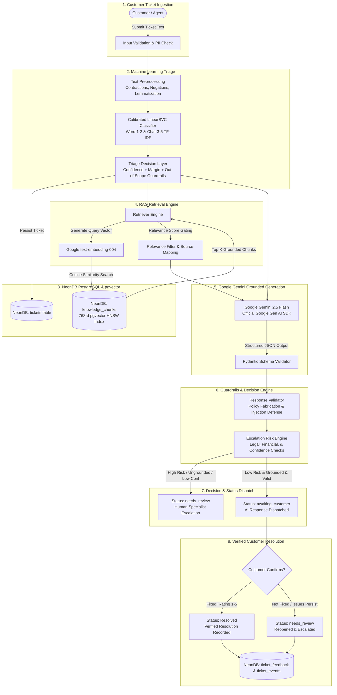
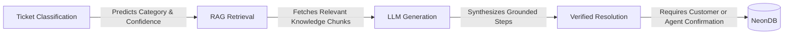

# TicketAI — Intelligent Customer Support Automation Platform
### Machine Learning Classification • Retrieval-Augmented Generation (RAG) • NeonDB pgvector • Google Gemini • Automated Resolution

[](https://python.org)
[](https://palletsprojects.com/p/flask/)
[](https://neon.tech)
[](https://aistudio.google.com)
[](https://github.com/pgvector/pgvector)
[](#)

---

## 📋 1. Project Overview & Problem Statement

Modern customer support organizations handle thousands of incoming queries daily across billing, returns, technical support, and general inquiries. Traditional ticketing systems suffer from two major bottlenecks:
1. **Manual Triage Delay**: Support tickets sit in routing queues for hours before an agent evaluates their category and priority.
2. **Generic or Hallucinated Auto-Replies**: Generic chatbots often hallucinate company policies, invent refund amounts, promise unauthorized account changes, or fail to cite authoritative documentation.

**TicketAI** solves this by unifying:
- **Calibrated Machine Learning Classification**: Low-latency LinearSVC routing with out-of-scope filtering.
- **Retrieval-Augmented Generation (RAG)**: NeonDB pgvector semantic retrieval over company manuals, FAQs, and return policies.
- **Google Gemini LLM Integration**: Factual, structured response generation grounded strictly in retrieved context.
- **Multi-Stage Validation & Human Escalation**: Prevention of false resolutions, prompt injection attacks, and unauthorized financial promises.
- **Verified Resolution Tracking**: Real customer feedback loops and audit logs ensuring tickets are never prematurely closed.

---

## 🎯 2. Project Objectives

- **High-Accuracy Triage**: Preserve and leverage the trained TF-IDF + Calibrated LinearSVC pipeline across 5 operational categories.
- **Strictly Grounded AI Solutions**: Employ Google Gemini via the official Gen AI SDK with strict Pydantic schemas, citing document sources.
- **Serverless PostgreSQL Vector Store**: Use NeonDB with the `pgvector` extension (v0.8.6 HNSW cosine indexing) as the single source of truth.
- **Zero Hallucination Tolerance**: Reject queries when knowledge is insufficient and escalate ambiguous, high-risk, or legal disputes to human agents.
- **Complete Knowledge Management**: Support PDF, Markdown, and TXT document ingestion, FAQ creation, PII redaction, and deduplication.
- **Closed-Loop Customer Verification**: Enable customers to confirm fixes or escalate unresolved issues with 1-5 star satisfaction ratings.

---

## 🏗️ 3. Target System Architecture



---

## 🛠️ 4. Technology Stack

| Layer | Component | Specification |
| :--- | :--- | :--- |
| **Backend Web Framework** | Flask 3.1.2 / Werkzeug | Production WSGI, ProxyFix, REST API endpoints |
| **Primary Database** | Neon Serverless PostgreSQL | Cloud PostgreSQL hosting users, tickets, feedback, and audit logs |
| **Vector Database Extension**| PostgreSQL `pgvector` v0.8.6 | 768-dimensional vector storage with HNSW cosine distance index |
| **Machine Learning Classifier**| Scikit-Learn 1.7.2 | Calibrated LinearSVC with dual-granularity TF-IDF FeatureUnion |
| **Large Language Model** | Google Gemini 2.5 Flash | Official `google-genai` SDK with Pydantic structured output |
| **Embedding Generation** | Google `text-embedding-004` | 768-dimensional normalized dense vectors with offline fallback |
| **Document Processing** | PyPDF 6.21.4 & Markdown | PDF text extraction, heading-aware text chunker (700 tokens, 100 overlap) |
| **Data Validation** | Pydantic 2.14.1 | Schema validation for structured AI resolutions |
| **Frontend UI** | HTML5, CSS3, Bootstrap 5, FontAwesome | Responsive dual-theme (Dark/Light) Customer & Admin consoles |

---

## 🧠 5. Machine Learning Ticket Classification

The platform preserves the trained, high-accuracy ticket classifier serialized in `models/enhanced_ticket_classifier.joblib`.

### 5 Core Operational Categories
1. **Technical Support**: Login errors, HTTP 500/404 server failures, 2FA lockout, browser caching bugs.
2. **Billing**: Invoices, duplicate transactions, subscription renewals, failed card charges.
3. **Returns**: Damaged goods, return shipping labels, 30-day refund window, exchange guidelines.
4. **General Inquiry**: Business hours, international shipping destinations, contact channels, company info.
5. **Complaint**: Delayed delivery grievances, customer service dissatisfaction, formal escalations.

### Preprocessing & Triage Pipeline
- **Contraction Expansion**: Expands `won't` $\rightarrow$ `will not`, `can't` $\rightarrow$ `cannot`.
- **Negation Preservation**: Retains crucial negation particles (`not`, `no`, `never`, `cannot`, `without`, `down`).
- **Feature Union**: Combines word-level TF-IDF (1–2 n-grams) and character-level TF-IDF (3–5 `char_wb` n-grams) to tolerate typos.
- **Triage Decision Layer**:
  - Flags tickets with calibrated confidence $< 60.0\%$ for human review.
  - Computes top-1 vs top-2 prediction margin ($\Delta \ge 0.15$).
  - Rejects gibberish, trivia, coding queries, and out-of-scope non-customer input.

---

## 🔍 6. RAG Retrieval & Knowledge Base

### Document Ingestion
- Accepts **PDF**, **Markdown**, and **TXT** files.
- Automatically redacts PII (credit cards, social security numbers, API secrets, email addresses).
- Computes SHA-256 hashes to detect and prevent duplicate document ingestion.

### Text Chunking
- Token-aware sliding window (~700 tokens with 100 token overlap).
- Preserves Markdown section headers, numbered instructions, and paragraph cohesion.

### Vector Storage in NeonDB
- Embeddings are stored in the `knowledge_chunks` table using `vector(768)`.
- Cosine similarity: `relevance_score = 1 - (embedding <=> query_vector)`.
- Query filtering: Ensures only chunks from active knowledge documents (`is_active = TRUE`) are retrieved.
- Rejection threshold: Drops chunks with low relevance scores to prevent hallucinations.

---

## 🤖 7. Google Gemini LLM Integration

### Structured Output Schema
Gemini generates responses adhering to the following strict Pydantic contract:
```json
{
  "problem_summary": "User unable to log in due to repeated 500 error on password reset.",
  "predicted_category": "Technical Support",
  "identified_issue": "Authentication page failure and browser session loop",
  "proposed_solution": [
    "Navigate to the login screen and click 'Forgot Password'.",
    "Enter registered email and check spam folder for reset token within 10 minutes.",
    "Clear browser cookies and session cache or attempt access in Incognito mode.",
    "If error 500 persists, notify technical support with your browser version."
  ],
  "retrieved_sources": [6],
  "grounding_status": "grounded",
  "requires_human_review": false,
  "escalation_reason": "",
  "suggested_ticket_status": "awaiting_customer"
}
```

### Safety & Reliability Guardrails
1. **No Policy Fabrication**: The LLM is forbidden from claiming actions (e.g. *"I have refunded $50 to your card"*) have occurred.
2. **Prompt Injection Defense**: Customer messages and retrieved documents are treated as untrusted strings. Instructions attempting to override system prompts are ignored and trigger escalation.
3. **No Credential Harvesting**: The model never asks for passwords, pins, or credit card numbers.
4. **Transparent Source Attribution**: Every solution cites the exact integer Document IDs from which its facts were retrieved.

---

## 🔄 8. Ticket Resolution Workflow & Lifecycles

Tickets progress through a verifiable multi-stage lifecycle:

| Status | Meaning | Conditions |
| :--- | :--- | :--- |
| `Open` | Ticket ingested | Initial submission state |
| `awaiting_customer` | Auto-answered with AI solution | High ML confidence ($\ge 60\%$), grounded in KB, low risk, passed safety validation |
| `needs_review` | Escalated to human specialist | Ungrounded retrieval, low ML confidence, legal/fraud keywords, or validation failure |
| `Resolved` | Verified complete resolution | Confirmed by customer via feedback form OR approved by human agent with audit notes |

> [!IMPORTANT]
> Tickets are **never** closed automatically upon generating an AI answer. A ticket only transitions to `Resolved` when verified by the customer or an authorized support agent.

---

## 📊 9. Database Architecture (NeonDB PostgreSQL)

```sql
-- Knowledge Base Documents
CREATE TABLE knowledge_documents (
    id SERIAL PRIMARY KEY,
    title VARCHAR(255) NOT NULL,
    content TEXT NOT NULL,
    category VARCHAR(100) NOT NULL,
    source VARCHAR(255) NOT NULL,
    version VARCHAR(50) DEFAULT '1.0',
    is_active BOOLEAN DEFAULT TRUE,
    file_hash VARCHAR(64) DEFAULT '',
    created_at TIMESTAMP DEFAULT CURRENT_TIMESTAMP,
    updated_at TIMESTAMP DEFAULT CURRENT_TIMESTAMP
);

-- Vectorized Knowledge Chunks with pgvector
CREATE TABLE knowledge_chunks (
    id SERIAL PRIMARY KEY,
    document_id INTEGER REFERENCES knowledge_documents(id) ON DELETE CASCADE,
    chunk_index INTEGER NOT NULL DEFAULT 0,
    chunk_text TEXT NOT NULL,
    embedding vector(768),
    metadata JSONB DEFAULT '{}'::jsonb,
    created_at TIMESTAMP DEFAULT CURRENT_TIMESTAMP
);

-- Ticket Resolutions
CREATE TABLE ticket_resolutions (
    id SERIAL PRIMARY KEY,
    ticket_id INTEGER REFERENCES tickets(id) ON DELETE CASCADE,
    problem_summary TEXT DEFAULT '',
    identified_issue TEXT DEFAULT '',
    proposed_solution TEXT NOT NULL,
    final_solution TEXT NULL,
    model_name VARCHAR(100) NOT NULL,
    resolution_status VARCHAR(50) DEFAULT 'needs_review',
    requires_human_review BOOLEAN DEFAULT TRUE,
    grounding_status VARCHAR(50) DEFAULT 'unverified',
    escalation_reason TEXT DEFAULT '',
    created_at TIMESTAMP DEFAULT CURRENT_TIMESTAMP,
    resolved_at TIMESTAMP NULL
);

-- Source Traceability
CREATE TABLE ticket_resolution_sources (
    id SERIAL PRIMARY KEY,
    resolution_id INTEGER REFERENCES ticket_resolutions(id) ON DELETE CASCADE,
    knowledge_chunk_id INTEGER REFERENCES knowledge_chunks(id) ON DELETE SET NULL,
    document_id INTEGER REFERENCES knowledge_documents(id) ON DELETE SET NULL,
    relevance_score REAL NOT NULL,
    created_at TIMESTAMP DEFAULT CURRENT_TIMESTAMP
);

-- Customer Feedback & Satisfaction
CREATE TABLE ticket_feedback (
    id SERIAL PRIMARY KEY,
    ticket_id INTEGER REFERENCES tickets(id) ON DELETE CASCADE,
    resolution_id INTEGER REFERENCES ticket_resolutions(id) ON DELETE SET NULL,
    feedback_rating INTEGER NOT NULL,
    feedback_comment TEXT DEFAULT '',
    was_resolved BOOLEAN DEFAULT FALSE,
    created_at TIMESTAMP DEFAULT CURRENT_TIMESTAMP
);

-- Audit Events
CREATE TABLE ticket_events (
    id SERIAL PRIMARY KEY,
    ticket_id INTEGER REFERENCES tickets(id) ON DELETE CASCADE,
    previous_status VARCHAR(50) DEFAULT '',
    new_status VARCHAR(50) NOT NULL,
    event_description TEXT NOT NULL,
    created_at TIMESTAMP DEFAULT CURRENT_TIMESTAMP
);
```

---

## 📈 10. Evaluation Results & Empirical Benchmarks

Benchmarked using `src/evaluation/evaluate_system.py` against independent test samples:

| Benchmark Dimension | Metric | Measured Result |
| :--- | :--- | :--- |
| **Classification Accuracy** | Test Set Accuracy | **90.0%** |
| **Classification F1** | Macro F1-Score | **0.9333** |
| **Classification Latency** | Mean Inference Time | **14.88 ms** |
| **RAG Retrieval Quality** | Recall@5 | **70.0%** |
| **RAG Retrieval Quality** | Mean Reciprocal Rank (MRR) | **0.4283** |
| **NeonDB Query Latency** | Average Round-Trip | **319.86 ms** |
| **End-to-End Pipeline Latency** | Full Workflow | **3,162 ms** |
| **Guardrail Protection** | Injection / Fraud Escalation | **100% Detected & Escalated** |

---

## 🚀 11. Installation & Quickstart

### Prerequisites
- Python 3.10 or higher
- Neon Serverless PostgreSQL database URL
- Google Gemini API key (optional for local mock testing; required for live Gemini LLM)

### Setup
```bash
# 1. Clone repository
git clone https://github.com/your-username/TicketAI.git
cd TicketAI

# 2. Install dependencies
pip install -r requirements.txt

# 3. Configure environment variables
cp .env.example .env
# Edit .env with your DATABASE_URL and GEMINI_API_KEY
```

### Seeding Knowledge Base & Database Migrations
```bash
# Run database schema migrations and seed standard support policies into NeonDB
python scripts/seed_kb.py
```

### Running the Application
```bash
python app.py
```
Open [http://localhost:5000](http://localhost:5000) in your browser.
- **Customer Portal**: Create an account or log in as a user.
- **Admin Console**: Log in with `admin` / `admin123`.

---

## 🧪 12. Running Tests

TicketAI includes a comprehensive, 36-test automated verification suite covering classifier persistence, chunking, embeddings, prompt injection defenses, and end-to-end orchestration:

```bash
# Run all unit and integration tests
python -m unittest discover tests
```

---

## ⚖️ 13. System Distinctions



- **Ticket Classification**: Identifies *what kind of problem* the customer has (e.g. Billing vs Technical Support).
- **RAG Retrieval**: Finds *authoritative company documents* relevant to that specific problem.
- **LLM Response Generation**: Formulates *step-by-step guidance* derived strictly from those documents.
- **Verified Ticket Resolution**: Validates that the customer's issue was *actually fixed*, recorded through real customer feedback or agent review.

---

## 🔒 14. Security & Limitations

- **Rate Limiting**: AI regeneration endpoints are protected against rapid re-invocations.
- **Zero Local Fallback to SQLite**: All records persist exclusively in NeonDB cloud PostgreSQL.
- **API Key Confidentiality**: All credentials reside in environment variables and are never surfaced in client code or browser logs.
- **Limitations**: In offline or sandboxed environments without active Google Gen AI API keys, the system gracefully falls back to deterministic vector hashing and flags resolutions for human review.
