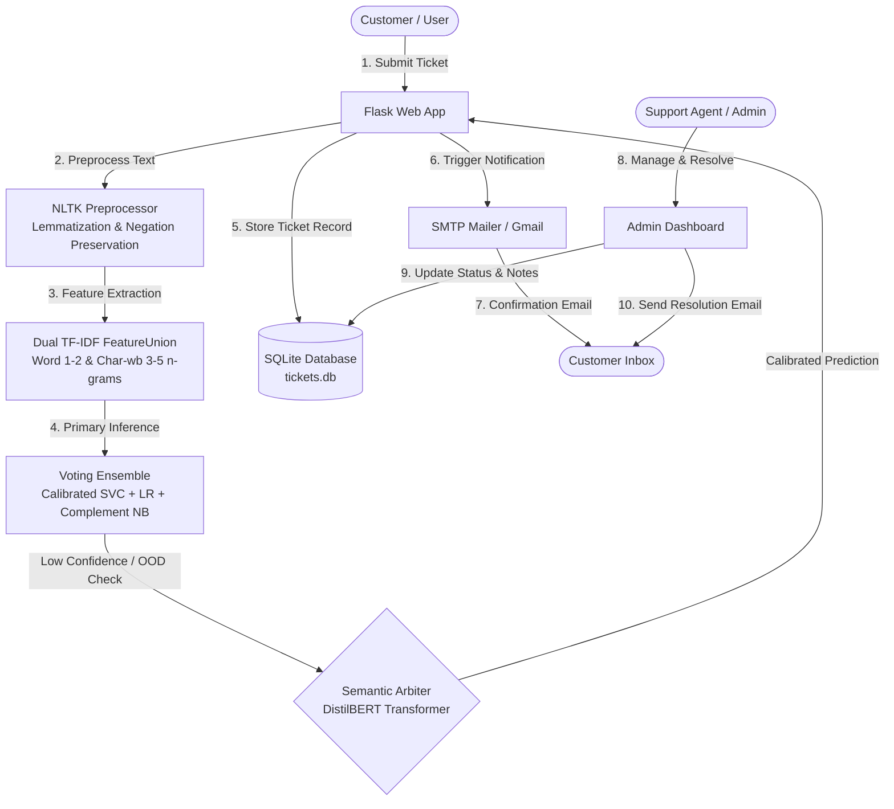

# TicketAI - Intelligent Customer Support Ticket Classification & Automation Platform


**TicketAI** is an enterprise-grade AI-powered customer support ticketing and automated triage platform. It combines a soft **Voting Ensemble** of calibrated linear models with pre-trained **DistilBERT Transformers** (for semantic and out-of-distribution reasoning) in a full-stack Flask web application. The system automatically categorizes, prioritizes, and routes incoming customer support queries, producing calibrated confidence scores, multi-category rankings, automated transactional emails, and comprehensive administrative oversight.

---

## 🌟 Key Features

### 🧠 Dual-Engine Machine Learning & NLP Architecture
* **5 Core Operational Categories**:
  * 🛠️ **Technical Support**: Login issues, 500/404 server errors, software bugs, app crashes, and connectivity drops.
  * 💳 **Billing**: Invoices, duplicate charges, payment failures, subscription renewals, and fee inquiries.
  * 📦 **Returns**: Return requests, damaged goods, incorrect shipments, exchanges, and refunds.
  * ℹ️ **General Inquiry**: Operating hours, store locations, product specifications, compatibility, and warranty info.
  * ⚠️ **Complaint**: Service dissatisfaction, delivery delays, rude staff, and executive escalations.
* **Dual-Granularity Feature Extraction**:
  * **Word-Level TF-IDF** (1–2 n-grams, 12,000 max features, sublinear scaling) for contextual phrases.
  * **Character-Level TF-IDF** (3–5 n-grams, 20,000 max features, `char_wb`) to robustly absorb misspellings, typos, and morphological inflection.
* **Calibrated Voting Ensemble**:
  * Combines **Calibrated LinearSVC**, **L2-Regularized Logistic Regression**, and **Complement Naive Bayes**.
  * Employs soft voting with probability calibration (`CalibratedClassifierCV`) to provide transparent posterior probabilities.
* **DistilBERT Semantic Arbiter (Zero-Shot OOD Engine)**:
  * Uses `typeform/distilbert-base-uncased-mnli` zero-shot NLI to evaluate edge cases, colloquial phrasing, and domain shifts (e.g., hospitality/dining complaints) where keyword-based models might otherwise default incorrectly.
* **Production Reliability & Guardrails**:
  * **Strict Zero-Leakage Holdout**: 100% disjoint train/test partitions (5,156 raw train vs. 1,290 strictly held-out test; 0 overlapping records).
  * **Curated Training Enrichment**: Augments training data with 520 curated colloquial and slang patterns (**5,676 total training records**) without ever exposing test records.
  * **Ambiguity Detection**: Queries under 3 words or 12 characters are capped at 50% confidence.
  * **Automated Human Triage**: Tickets with confidence below 60% are automatically flagged (`needs_human_review = True`).
* **Benchmarked High Accuracy**:
  * **99.46% test accuracy**, **0.9946 weighted F1-score**, and **0.9946 macro F1-score** across the held-out test split.

---

### 💻 Full-Stack Web Application
* **Customer Portal**:
  * Real-time ticket submission with live interactive AI categorization preview.
  * Personal ticket history tracking with status badges (*Open*, *In Progress*, *Resolved*).
  * Detailed ticket view with resolution notes and AI confidence scores.
* **Agent & Admin Management Console**:
  * Role-Based Access Control (RBAC) separating regular users from support personnel.
  * Real-time KPI statistics (Total, Open, Resolved, and per-category distributions).
  * Multi-attribute filtering by ticket status and category.
  * Integrated resolution workflow: add resolution notes, mark tickets as resolved, and dispatch resolution emails.
* **Theme System**:
  * Native Dark and Light mode powered by CSS custom properties ([theme.css](file:///c:/ai_ticket/static/css/theme.css)) and persistent localStorage state ([theme.js](file:///c:/ai_ticket/static/js/theme.js)).
* **Transactional Email Notifications**:
  * SMTP/MIME integration sending branded HTML confirmation emails upon ticket submission.
  * Automated resolution notification emails containing agent resolution summaries.
* **Configurable Environment**:
  * Uses `.env` and `python-dotenv` for all secrets, database paths, admin credentials, and SMTP mail settings.

---

## 🏗️ System Architecture



---

## 📁 Project Structure

```text
ai_ticket/
├── .env                                          # Local environment configuration (git-ignored)
├── .env.example                                  # Template for environment variables
├── app.py                                        # Main Flask application (routes, auth, ML inference, email)
├── requirements.txt                              # Pinned Python package dependencies
├── tickets.db                                    # SQLite database (auto-created on startup)
├── download.py                                   # NLTK resources setup script (stopwords, wordnet, punkt)
├── static/                                       # Frontend static assets
│   ├── css/
│   │   └── theme.css                             # Unified Light & Dark mode styling tokens
│   └── js/
│       └── theme.js                              # Theme persistence and toggle listener
├── templates/                                    # Jinja2 HTML templates
│   ├── landing.html                              # Public landing page
│   ├── index.html                                # Customer ticket submission with live AI preview
│   ├── dashboard.html                            # User ticket history and status tracking
│   ├── admin_dashboard.html                      # Administrative triage, filtering & resolution portal
│   ├── login.html                                # User & agent login
│   ├── register.html                             # User registration
│   └── settings.html                             # User preferences & account settings
├── models/                                       # Machine learning models & training artifacts
│   ├── customer_support_tickets_train_split.csv  # Verified training split (5,156 records, 0 leakage)
│   ├── customer_support_tickets_test_split.csv   # Strictly held-out test split (1,290 records)
│   ├── train_model.py                            # Production training, benchmarking & serialization script
│   ├── ticket_classification_updated.ipynb       # Interactive Jupyter notebook (EDA, training, validation)
│   ├── enhanced_ticket_classifier.joblib         # Production serialized ensemble pipeline
│   ├── enhanced_customer_support_model_90plus.pkl# Serialized fallback model backup
│   └── enhanced_model_metadata.json              # Model metrics, per-class stats & evaluation metadata
└── documentation/                                # Academic papers, project reports & slide decks
    ├── 1-s2.0-S0957417423004864-main.pdf         # Reference literature
    ├── AI-basedSupportTicketSystem_IWEMB2022.pdf # Domain benchmark paper
    ├── TicketAI_Academic_Presentation_15_slides.pptx
    └── Main Report  draft.docx
```

---

## ⚙️ Installation & Setup

### Prerequisites
* **Python 3.10, 3.11, 3.12, or 3.13**
* **Git**

### 1. Clone the Repository
```bash
git clone https://github.com/irfan-shekh/ai_ticket.git
cd ai_ticket
```

### 2. Create and Activate a Virtual Environment

**Windows (PowerShell):**
```powershell
python -m venv env
.\env\Scripts\Activate.ps1
```

**macOS / Linux:**
```bash
python3 -m venv env
source env/bin/activate
```

### 3. Install Dependencies
```bash
pip install -r requirements.txt
```

### 4. Download NLTK Corpora
```bash
python download.py
```

### 5. Configure Environment Variables
Copy the example environment file and adjust your settings:

**Windows (PowerShell):**
```powershell
copy .env.example .env
```

**macOS / Linux:**
```bash
cp .env.example .env
```

Edit `.env` to configure your parameters:
```ini
# Flask Application Configuration
SECRET_KEY=your-secure-secret-key
DATABASE=tickets.db

# Email Notification Configuration (SMTP / Gmail)
SMTP_SERVER=smtp.gmail.com
SMTP_PORT=587
EMAIL_USER=your-email@gmail.com
EMAIL_PASSWORD=your-gmail-app-password

# Admin Credentials
ADMIN_USERNAME=admin
ADMIN_PASSWORD=admin123
```
> **Tip for Gmail:** Generate an **App Password** via Google Account > Security > 2-Step Verification > App Passwords.

---

## 🚀 Running the Application

Start the Flask server:
```bash
python app.py
```

Navigate to:
```text
http://127.0.0.1:5000
```

### Default Credentials
| Role | Username | Password | Notes |
| :--- | :--- | :--- | :--- |
| **Admin** | `admin` | `admin123` | Full access to `/admin` dashboard |
| **User** | `demo` | Register via `/register` | Access to ticket creation and history |

---

## 🧪 Model Training & Retraining

To train, benchmark, and serialize the production ensemble pipeline:

```bash
python models/train_model.py
```

### Pipeline Steps:
1. **Data Ingestion**: Reads `customer_support_tickets_train_split.csv` (5,156 samples) and `customer_support_tickets_test_split.csv` (1,290 samples).
2. **Train Set Enrichment**: Adds 520 curated colloquial tickets to training (**5,676 total training records**).
3. **Leakage Verification**: Verifies zero overlapping text samples between train and test sets.
4. **Text Preprocessing**: Normalizes text, cleans contractions, preserves negation terms, and applies WordNet lemmatization.
5. **Feature Union**: Generates combined word-level TF-IDF (12,000 features) and character-level n-grams (20,000 features).
6. **5-Fold Stratified Cross-Validation**: Evaluates LinearSVC, Logistic Regression, Complement Naive Bayes, and the soft Voting Ensemble.
7. **Artifact Export**: Saves serialized pipelines to `enhanced_ticket_classifier.joblib` and updates `enhanced_model_metadata.json`.

You can also run the full exploratory analysis and benchmark interactively in [ticket_classification_updated.ipynb](file:///c:/ai_ticket/models/ticket_classification_updated.ipynb).

---

## 📡 REST API Reference

### 1. `POST /classify`
Submits a ticket description for automated AI classification and database recording.

* **Headers**: `Content-Type: application/json`
* **Authentication**: Requires active user session

#### Request Body
```json
{
  "ticket_text": "I was charged twice on my credit card for invoice #INV-4820",
  "notification_email": "customer@example.com"
}
```

#### Response (`200 OK`)
```json
{
  "category": "Billing",
  "confidence": 84.4,
  "confidence_level": "High",
  "needs_human_review": false,
  "top_predictions": [
    {"category": "Billing", "confidence": 84.4},
    {"category": "Technical Support", "confidence": 8.1},
    {"category": "General Inquiry", "confidence": 4.5}
  ],
  "description": "Payment issues, invoices, billing questions, and subscription renewals",
  "ticket_id": 14,
  "email_sent": true,
  "success": true
}
```

---

### 2. `POST /admin/resolve_ticket`
Resolves a ticket and sends an automated notification email to the customer.

* **Headers**: `Content-Type: application/json`
* **Authentication**: Requires admin session (`is_admin = True`)

#### Request Body
```json
{
  "ticket_id": 14,
  "resolution_notes": "Duplicate transaction reversed. Funds will reflect within 2-3 business days."
}
```

#### Response (`200 OK`)
```json
{
  "success": true,
  "message": "Ticket resolved successfully",
  "email_sent": true
}
```

---

### 3. `GET /api/tickets`
Fetches tickets in JSON format (user receives their own tickets; admin receives all tickets).

* **Authentication**: Requires active session

---

## 📊 Benchmark Results (Verified Disjoint Test Set)

Evaluated strictly on the held-out test partition (`customer_support_tickets_test_split.csv`, 1,290 samples; 0 train-test leakage):

| Category | Precision | Recall | F1-Score | Test Support |
| :--- | :---: | :---: | :---: | :---: |
| **Billing** | **1.0000** | **0.9960** | **0.9980** | 250 |
| **Complaint** | **0.9922** | **0.9884** | **0.9903** | 259 |
| **General Inquiry** | **0.9960** | **0.9920** | **0.9940** | 249 |
| **Returns** | **0.9887** | **0.9962** | **0.9925** | 264 |
| **Technical Support** | **0.9963** | **1.0000** | **0.9981** | 268 |
| **Overall Accuracy** | — | — | **99.46%** | **1,290 samples** |
| **Weighted F1-Score**| — | — | **0.9946** | — |
| **Macro F1-Score**   | — | — | **0.9946** | — |

---

## 📄 License
This project is licensed under the MIT License - see the [LICENSE](LICENSE) file for details.
